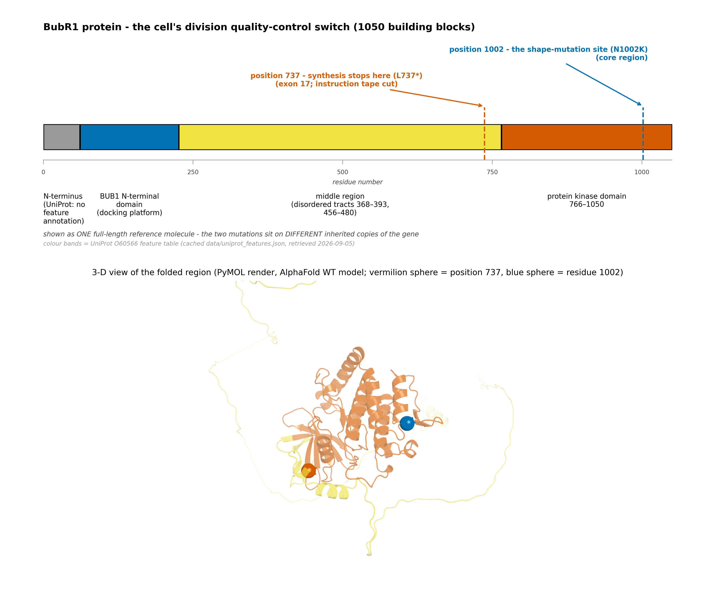
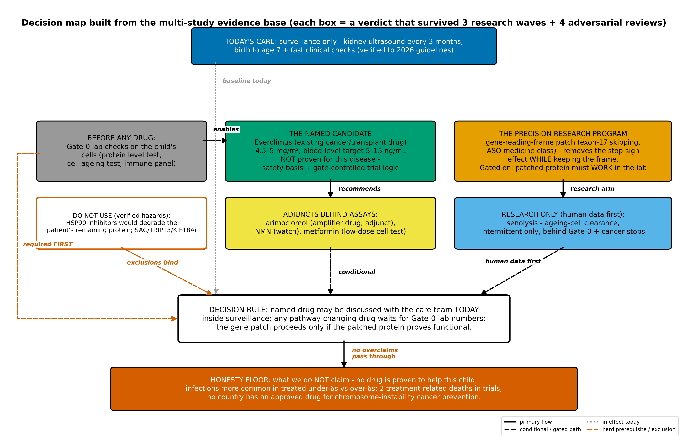
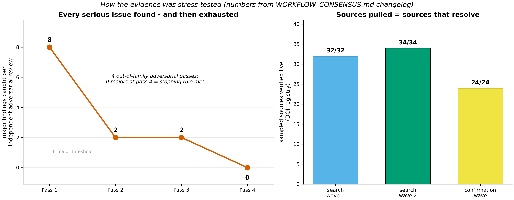
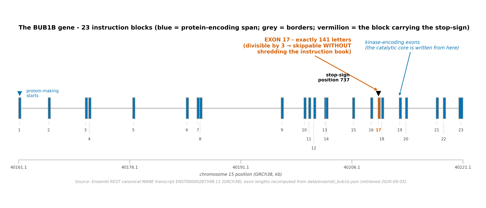

# Repurposing and Precision-Therapeutic Landscape for Biallelic BUB1B Mosaic Variegated Aneuploidy

**Team:** fulopjoz · **Track 2 - Drug Repurposing** · MVA Hackathon 2026
Companion documents: lay-accessible report (`TRACK2_LAY_REPORT.md`), evidence pack (`evidence/`, see §9)

---

## 1. Executive summary

The proband carries compound-heterozygous BUB1B alleles - a nonsense variant (p.Leu737Ter) and a kinase-domain missense variant (p.Asn1002Lys) - producing Mosaic Variegated Aneuploidy (MVA) with the established early-childhood tumor-predisposition phenotype (**Figure 2**) [E01][E20].

 Our analysis of the therapeutic landscape rests on one mechanistic anchor: **both alleles deplete functional BubR1 by abundance, not by catalytic loss**. One allele is destroyed as message (nonsense-mediated decay, NMD) [E42]; the other encodes a structurally fragile protein whose affected residue participates in an evolutionarily conserved contact within the kinase domain [E39][E38]. The cellular dose–response literature (inducible-shRNA titration of wild-type BUBR1 in HeLa; Suijkerbuijk et al., Fig. 4D) links checkpoint fidelity to abundance - essentially intact near 13 % of endogenous, mis-segregating toward ~6 % [E04]; that experiment bounds the question without establishing a patient-specific threshold. Patient-derived biallelic cells show mutant full-length BubR1 at two- to six-fold reduced abundance, not a percent-of-normal figure [E04]. The normal BubR1 abundance [E04].

That grammar (**Figure 4**) - *raise, spare, or at minimum not further lower residual functional BubR1* - admits exactly one approved drug that survives pediatric safety and monitoring constraints (**everolimus**, inside gates), one mechanism-matched precision program (ASO-mediated skipping of the 141-nt frame-preserving exon 17, whose utility is decided by a single construct-function assay), a short list of adjuncts admissible only behind laboratory gates, and a series of **mechanism-justified exclusions** (HSP90, TRIP13/KIF18A/Mps1, autophagy, AICAR axes) that are as load-bearing as the positives.

We support these verdicts with an evidence program of unusual rigor: three literature waves with recorded queries, 90/90 registry-verified citations, four staged adversarial review passes with major-finding decay 8→2→2→0 to the pre-declared ceiling (**Figure 5**), and a deterministic weighted decision matrix over four candidate submission architectures [E40][E40-SD]. A live five-registry census confirms no MVA intervention trial is registered anywhere [E21a]; the surveillance standard of care (renal ultrasound every three months, birth to age seven [E21][E22]) therefore remains the backbone onto which any drug discussion must graft.

**Nothing here is a prescription.** Every recommendation is expressed with its stopping gates, its safety counter-evidence quoted in full, and the assays required before any human exposure.

---

## 2. Mechanism characterization

### 2.1 Allele A - p.Leu737Ter: message-level null

The premature termination codon lies >50–55 nt upstream of the final exon–exon junction of ENST00000287598, satisfying the position rule for nonsense-mediated decay [E42]. In-frame escape is not documented for this construct; we treat the allele as an abundance null (≈0 % residual), consistent with the NMD rules literature [E42]. Therapeutic classes acting on the *remaining* allele (stabilization) or on the *reading frame* (exon skipping) therefore act on this side of the ledger; nonsense suppression (ataluren-class) was assessed and set aside on efficacy grounds in this context - the class carries a withdrawn EU indication and inconsistent readthrough evidence [E61].

### 2.2 Allele B - p.Asn1002Lys: fragile scaffold, competent message

The missense allele is scored 0.92 ("likely pathogenic") by AlphaMissense [E38]. The affected Asn1002 is conserved to *Drosophila*; in the fly kinase-domain crystal (PDB 6JKK) the residue equivalent to human N1002 sits in a 2.86 Å direct side-chain-to-backbone contact with the W978-equivalent residue [E39]. We re-measured this contact independently from the deposited coordinates during our structural validation pass (minimum any-atom distance 2.86 Å, ND2–backbone O; side-chain packing 3.81 Å; local helix RMSD 0.74 Å over the 996–1004 window) [E39] (**Figure 1**).

 Substitution of a lysine at this position predicts local destabilization and accelerated degradation rather than catalytic poisoning - which matters because BubR1's checkpoint role is largely catalysis-independent (scaffold/KARD function dominates; kinase activity is dispensable for checkpoint signaling in the key genetic analyses) [E04b]. We therefore model the allele as a **reduced-abundance, message-competent** contributor.

### 2.3 Genotype → phenotype: the abundance grammar

The only abundance-versus-fidelity dose-response in the literature comes from the cellular model in which the ~13 % and ~6 % values were measured: doxycycline titration of inducible BUBR1 shRNA in HeLa cells (immunoblot band-intensity of wild-type protein), with segregation essentially unperturbed near 13 % of endogenous and mis-segregation dominating near 6 % of endogenous (Suijkerbuijk et al., Fig. 4D) [E04]. The same study measured mutant full-length BubR1 in patient-derived biallelic cells at two- to six-fold reduced renders, acute mitotic delay (50 % exit within 68-114 min vs controls arrested) and two- to three-fold excess misalignment - never as a percent-of-normal abundance in this individual, and never as a therapeutic threshold [E04]. The biallelic state - one null, one fragile - places the proband's functional BubR1 in an unmeasured zone (measuring it is assay #6 of §5). The biallelic state - one null, one fragile - places the proband's functional BubR1 in the danger zone of that window (unmeasured in this individual; measuring it is assay #6 of §5). Downstream, BubR1 insufficiency disables spindle-assembly checkpoint stringency, producing mosaic aneuploidy [E18][E20] with the tumor spectrum of MVA (Wilms tumor, rhabdomyosarcoma-lineage and other embryonal neoplasms) [E20][E22]. The therapeutic grammar follows directly:

1. **Do not cut the fragile copy.** Anything that degrades a stability-compromised client protein (HSP90 inhibitors) is a genotype-specific hazard [E39].
2. **Do not weaken an already-insufficient checkpoint.** TRIP13, KIF18A, and direct SAC (Mps1) inhibition are mechanistically wrong-direction [E20b][E40].
3. **Raise or spare abundance if safely possible.** Stabilizing small molecules (arimoclomol; NAD⁺/SIRT2 axis) are admissible only behind the abundance assay [E50][E54][E55].
4. **Repair the message where the reading frame permits.** Exon 17 of BUB1B is 141 nt - divisible by three - so its ASO-mediated removal preserves the frame while deleting the premature stop [E42] (the exon-17 design is **Figure 3**).
5. **Never outrun the evidence.** Any approved-drug use rides inside monitoring gates with the pediatric safety counter-data quoted in the same breath as the rationale.

---

## 3. Evidence program (methods)

**Design.** Searching and review were separated by role: searcher agents produced the evidence memos enumerated in `evidence/MEMO_MANIFEST.md` [E40], and four staged review passes were run by agents spawned with fresh context and a hostile mandate. Reviewer independence is therefore by role and context, not by vendor: drafter and reviewers ran inside the same harness lineage and the records do not resolve which model filled which role, so a vendor-different pass remains future work. Every wave carried deterministic checks: at least five sampled identifiers per document re-resolved against the registry, PubMed re-fetch for load-bearing clinical claims, and live registry census queries with positive controls, so that a trial class known to exist must be returned by the same query that returns zero for this syndrome [E21a].

**Verification totals.** 90 of 90 sampled identifiers resolve to real papers [E40]. Adversarial review found majors 8→2→2→0 across four passes, with closure declared at the pre-declared ceiling when pass 4 returned zero and residual risk documented [E41]. Corrections caught mid-process are preserved inline with P-tags rather than silently repaired: a misattributed mouse experiment [P2-1], an overstated trial conclusion [P2-2].

**Decision architecture.** Four submission architectures were compared in a pre-declared weighted matrix; the surveillance-first, four-lane structure (O1) won with rank stability under all tested sensitivity perturbations of the weights [E40-SD].

**Provenance.** Every reference row carries its own verification trail (§8); the figures in `figures/` are committed renders, with the underlying primary sources (UniProt O60566 feature table, Ensembl MANE transcript, AlphaFold model, 6JKK structure) named in each caption. The 19 analytical memos (manifest `evidence/MEMO_MANIFEST.md`), the four adversarial review passes, and the contested-anchor adjudication memo are in the `evidence/` directory (§9).

**Generative-AI disclosure.** Literature search, synthesis, adversarial review, and drafting were performed by AI agents inside the Oh My Pi harness (drafter and reviewers on the same hosted model lineage - e-INFRA Kimi K3 - with reviewer independence by role and fresh context only), under the deterministic verification gates above; no patient data left whitelisted hosts; human sign-off precedes any submission use (programme rule).

---

## 4. Therapeutic landscape

### 4.1 Baseline: the standard of care is surveillance

The two governing sources as they stand in 2026 agree on the backbone: for all children with MVA, renal ultrasound every three months from birth to age seven (the window in which Wilms risk concentrates), clinical review attentive to abdominal mass, hematuria and myalgic symptoms, and deliberate avoidance of unnecessary radiation exposure; whole-body MRI is not recommended, and circulating tumor-DNA assays are not standard of care in any predisposition syndrome - the closest registered constitutional-predisposition liquid-biopsy program (CHARM2, n=1000) excludes chromosome-instability syndromes from eligibility [E47].

**One addition the governing sources do not carry, reported because three independent sources converge on it and one verified absence explains why it is missing.** A 2026 clinician-reviewed guide written for this specific genotype recommends, alongside the same three-monthly abdominal ultrasound, a **haematological blood check every three months to detect leukaemia** [E73]; the 2017 Japanese national management handbook for this syndrome likewise schedules a full blood count at every visit from three months of age into adulthood [E74]. The reason this does not appear in the governing sources is specific rather than accidental: the companion AACR document covering surveillance for children predisposed to **haematopoietic** malignancy does not name this syndrome, any of its seven causative genes, or chromosomal instability anywhere in its full text, although it discusses monosomy 7 throughout [E75]. Against that sits one published case of myelodysplasia with monosomy 7 in this genotype, which proceeded to a fatal transplant [E76]. We therefore report the blood item as a **grade-D convergence for the care team to weigh, not a recommendation this report makes**: its sources are a family guide and a national handbook rather than a graded guideline, the marrow evidence in this genotype is a single case, and a three-monthly blood count is nonetheless low-cost and low-harm, unlike the serial bone-marrow examinations the AACR document reserves for syndromes with established myelodysplasia risk. Risk quantification is honestly unsettled: one widely used patient-facing source lists Wilms risk ">85 %", while the 2024 AACR workshop paper holds the syndrome too rare for accurate estimation; we quote both and refuse a single number [E20][E22]. **What is not unsettled is the stratum.** Tumour risk in this disease tracks the severity of spindle-checkpoint impairment rather than the syndrome label: biallelic BUB1B and TRIP13 cells show severe checkpoint impairment and high embryonal tumour risk, whereas mosaic variegated aneuploidy caused by biallelic CEP57, whose cells show minimal checkpoint deficiency, is not associated with embryonal tumours [E20b], a split the 2024 synthesis states independently as tumour susceptibility depending on the genetic basis [E77]. The genotype at issue here sits in the severe-impairment, high-risk group, so the surveillance backbone rests on this genotype's own stratum rather than on an average across a family of disorders that differ on precisely this axis. The same stratification bounds transfer in the other direction, and we apply it below: evidence drawn from a different causative gene is labelled as such.

A live census of ClinicalTrials.gov, EU CTIS, EU-CTR, ISRCTN and ANZCTR (with positive-control queries proving search sensitivity) returns **zero registered intervention trials for MVA of any kind** [E21a]. Any eventual therapeutic attempt in this disease would be, verifiably, the first - which is an argument for more controls, never fewer.

### 4.2 Named repurposing candidate: everolimus, strictly inside gates

**Rationale.** Everolimus is the drug in the mapped landscape with the most extensive multi-year exposure record in children of this age (TSC-associated tumors; 111 exposed patients in the EXIST-1 final analysis; median exposure 47.1 months, with growth and puberty unaffected over that period) [E23a]. That is exposure evidence in another disease, not evidence of benefit in MVA. Its mechanistic fit is deliberately labeled low-grade: an mTOR brake would, if anything, act on growth competition - a direction for which direct evidence is neutral and absent - and *in vitro* work in aneuploid models shows killing of high-aneuploid-fraction cells on AMPK-activation chemistries [E58]; direct evidence of everolimus selectively disadvantaging aneuploid cells is **neutral and absent** - the only pertinent mammalian-model test found mTOR perturbation neutral on trisomic MEFs and never tested Bub1b-deficient cells [P2-1][E58]; a newer organism-level fly datum, with its transfer caveats, is adjudicated below ("Contested-anchor adjudication"). A third axis, distinct from both statements above, is whether an mTOR brake affects segregation fidelity in its own right, and on that axis the evidence is not neutral: one *in vitro* study reports that inhibition of the mTOR–p70S6K pathway by rapamycin induces chromosome malsegregation and CREST-positive micronuclei in human lymphocytes and lymphoblasts [E72]. We weight this low and flag it for monitoring rather than treat it as disqualifying — a single 1998 cell report, a different rapalog from the candidate, no replication located, and no chromosomal signal reported across years of pediatric mTOR-inhibitor exposure, although we locate no study that looked for one — but it is a caution, not a benefit, and it is reported here because the paragraph above would otherwise read as though no directional evidence existed at all. We therefore claim no therapeutic direction; the candidate's justification is its monitored-risk profile and pediatric feasibility, not a demonstrated disease mechanism.

**Dosing and monitoring window** (from label and trial-validated exposure bands [E24][E25]): 4.5–5 mg/m²/day (≈3.4–3.8 mg/day at a five-year-old's body-surface), trough concentration 5–15 ng/mL under therapeutic drug monitoring; a trial-validated low band of 3–7 ng/mL was effective in the TSC setting from approximately two years of age [E23]. This report’s decision tree prefers the low band with pre-specified NK-count monitoring and a hold-dose trigger, because the class contracts the natural-killer pool [E27][E28] that participates in clearing newly aneuploid, senescent cells [E17][E19] - the K243-acetylation site it would disturb is itself checkpoint-protective [E17a]; ironic in this disease, hence monitored by rule.

**Safety counter-evidence, quoted in full.** In EXIST-1's treated cohort, children under six had substantially more infections than treated children six and over (any infection 96 % vs 67 %; serious infections 35 % vs 7 %; single-arm data, no placebo comparison, accumulated over years of monitoring; FDA label §8.4) [E24][E23a]. Across the everolimus TSC program, **two treatment-related deaths, both pediatric**, are recorded (pneumonia/septic shock in the extension setting) [E25]. Vaccination responses, including live vaccines on the sibling drug sirolimus, are preserved in young children (~4.7 y) [E29] - the geriatric result (low-dose mTOR blockade *enhancing* vaccine responses in adults over 65 [E26]) is a different immune baseline and does not transfer to a developing child.

**Prevention precedent, correctly scoped.** PREVENT (2024) administered prophylactic sirolimus to asymptomatic TSC infants and held dosing in target (94 % of troughs in band) - the only prophylactic rapalog ever trialed in symptom-free infants [E30]. It was a Phase-1 feasibility study; it did not test tumor prevention, and **no drug has been shown to prevent tumors in any chromosomal-instability predisposition syndrome**. Aspirin in Lynch syndrome (CAPP program, mechanism anti-platelet/anti-inflammatory rather than MMR-directed [E46]) and metformin in Li-Fraumeni families (MILI, an ongoing adults-only protocol) are the neighboring precedents: risk-reduction signals at best, never prevention efficacy [E45][E60].

**Verdict, scored by dimension.** Mechanistic relevance: weak and contested (the mTORC1-hyperactivity datum[^sieben] is confined to heterozygous BubR1-carrier muscle, never measured biallelic). Functional rescue: none recorded in any MVA model. Safety-feasibility evidence: the strongest any candidate presents here (111-patient paediatric physician-supervised exposure). Hazard profile: known, quotable, monitored (under-6 infection strata; two paediatric treatment-related deaths). Feasibility: dosing and trough-monitoring bands established in children. Suitability as an *unvalidated repurposing hypothesis*: today-discussable with the care team inside surveillance and monitoring gates; not a prescription; evidence laboratory-grade, not clinical, in this disease. It is not the unique candidate by default of other candidates' missing exposure data - no on-mechanism candidate of any kind has MVA patient or clinical benefit evidence (§4.5, §4.6).

**Contested-anchor adjudication (recorded 2026-09-12).** The candidate choice above is the one point on which an independent out-of-family evidence review disagreed with this report (hard-penalizing rapalogs on an NK-immunosurveillance rationale). A three-wave adjudication against primary sources - artifacts `evidence/cycle1_nk.md`, `cycle1_fly.md`, `cycle1_mech.md`; integrated in `evidence/adjudication_rapalog_contested_anchor.md` - resolved as follows, and the human adjudicator elected to keep the candidate with this disclosure attached.

First, the penalize's own citation chain fails: its key mechanism citation (Santaguida et al., *Dev Cell* 2017 [E17]) contains no mTOR-inhibitor data anywhere. At the low dosing band named above (3-7 ng/mL troughs), dose-matched human evidence points the other way: trough-matched transplant patients (3.4-3.9 ng/mL) show expanded, more cytotoxic natural-killer cells with preserved NKG2D [E28a]; two low-dose randomized trials in an over-65 cohort showed *improved* immune outcomes [E26b][E26] - a geriatric baseline this report elsewhere declines to transfer to a five-year-old, cited here only as evidence that low-band mTOR blockade is not reliably immunosuppressive as a matter of drug class; NK contraction is documented only at oncologic dosing and in post-transplant lymphopenic reconstitution - neither applicable to the named band. The honest gap is stated: no study directly measures mTOR-inhibitor exposure against NK-mediated clearance of aneuploid cells, and the low-band preference with NK-count monitoring already in this section is retained as the operative answer.

Second, a genuinely new objection arrived from a different direction: in the 2026 Drosophila MVA-like model [E62], rapamycin gave only a marginal neuroblast-count rescue while brain-lobe area *worsened* by ~21 % (p = 0.041), and chaperone overexpression or ROS-scavenger expression restored brain size completely; the authors' translational sentence names chaperone/mitochondrial/apoptosis routes and omits TOR. Orthology-verified transfer limits on that datum: the model depletes bub3 (the fly BUB3 ortholog - itself a variegated-aneuploidy gene family member) and rod (the RZZ kinetochore scaffold; verified NOT the BUB1B ortholog - Ensembl Compara maps human BUB1B to fly Bub1, FBgn0031696), with acute near-null knockdown versus our patient's ~13 % hypomorph as the key divergence.

The net evaluation: the external hard-penalize has no valid citation basis; the new cell-autonomous objection is one organism-level signal carrying real transfer caveats, against multi-year real pediatric exposure data and dosing-band-matched human immune data. The question has therefore *relocated* - it is no longer "does the band suppress NK clearance?" (answered: probably not, at 3-7 ng/mL) but "does TOR inhibition stunt growth of aneuploid tissue?" (one caveated signal, zero human data; the pre-specified growth-watch in the monitoring gates is the operational answer). Everolimus therefore stays as the best-documented-pediatric-exposure candidate for today-discussion inside gates (evidence classified per-dimension in the Verdict above) - and the chaperone axis (arimoclomol-class) is elevated to first research priority behind the ASO program, carrying the explicit caveat that no pharmacological chaperone agent has yet been tested in any aneuploidy model.

### 4.3 Precision program: ASO-mediated exon-17 skipping

The nonsense allele can, in principle, be repaired at the message level. BUB1B exon 17 is 141 nt - divisible by three - so ASO-mediated exclusion of the exon preserves the downstream reading frame while removing the premature termination codon (computed from the reference MANE transcript; skipping junctions scored donor 9.66 / acceptor 9.29 by MaxEnt, with zero PESS silencer octamers and RESCUE-ESE density 113.5/kb, comparable to the skipping-proven DMD exon 51) [E42][E44a].

**Construct.** Skipping exon 17 (141 nt) yields p.Glu715_Gly762delinsGly - in prose, Δ716-762 (+E715G): the junction re-encodes residue 715 (Glu→Gly) and destroys residues 716-762 (-47 amino acids). This description is sequence-derived from the versioned MANE transcript (ENST00000287598.11, end-to-end reconstruction in `evidence/exon_skip/reconstruct_exon17.py`, reference fetches committed; unit tests in `checks/test_exon17_reconstruct.py`) - not from integer arithmetic: the exon begins mid-codon (phase 1), so the 141-nt deletion destroys 46 complete interior codons and consumes the two boundary codons, of which residue 715 is junction-recoded. The deletion touches the KARD boundary (residue 716 deleted, 715 substituted), so the decisive assay must read out error-correction function, not abundance alone [E40-P2][E44a].

**Benefit model, stated as a model.** Assuming the second allele contributes its fragile residual and the patched allele is functional, our documented back-of-envelope estimate places combined functional BubR1 at 16-22 % of normal. Whether that suffices is unresolved by design: the only abundance-fidelity dose-response found (segregation essentially intact near 13 %, mis-segregating near 6 % of endogenous) was measured on wild-type BUBR1 titration in HeLa cells (Suijkerbuijk Fig. 4D) [E04] - it bounds the question; it is not a validated therapeutic threshold, and patient-line measurements are fold-reductions, not percent-of-normal. The estimate is assumption-dependent, not a measurement; its entire value stays conditional on construct #4 functionality (§5) [E40-P2][E44a].

**Precedent and feasibility.** Splice-switching ASOs are approved in Duchenne muscular dystrophy (eteplirsen class) and spinal muscular atrophy (nusinersen), including in very young children [E34]. The bespoke n-of-1 path is industrialized: milasen went diagnosis-to-first-dose in under 12 months [E31]; the n-Lorem model prices a per-patient lifetime program at ≈$1M [E32]; core chemistry patents have expired [E33].

**The two honest problems.**
1. **Construct function is unproven.** No one has tested whether the Δ716-762(+E715G) BubR1 construct folds, localizes to kinetochores, and sustains checkpoint signaling - this is assay #4, the single decisive experiment of the entire program (§5). The patch is allele-non-specific: it would skip exon 17 of the missense copy too; if the construct is non-functional, the remaining copy is broken as well. This is why the assay precedes any human exposure [E40-P2].
2. **Delivery is the open frontier.** No approved ASO has demonstrated splice correction in whole-body, non-muscle, non-CNS tissues; muscle and spinal cord are proven, everything else is not [E36]. Because MVA's instability is body-wide (renal, muscular, and other embryonal tumors), organ-limited delivery would cover only a fraction of the risk. The systemic small-molecule risdiplam shows that body-wide splice modulation is chemically achievable [E37] - though the systemic splice-modifying small-molecule risk exemplar here is adult, and must not be transferred as pediatric evidence: branaplam was terminated in the adult VIBRANT-HD Huntington's-disease trial after peripheral neuropathy in 18 of 21 treated participants (85.7 %; *Nat Med* 2026, 18 of 21 (85.7 %); adult Huntington's disease population; https://doi.org/10.1038/s41591-025-04117-4) - a different molecule-class hazard signal, in a different disease, in adults; the infant SMA programme is a separate, completed trial with its own data (manuscript in preparation) - and a novel small molecule remains a longer program than an ASO.

### 4.4 Adjuncts, behind laboratory gates only

- **Arimoclomol** (heat-shock-response amplifier, approved from age two for Niemann-Pick C): conceivable stabilizer of the fragile copy; no study shows this class raising a mutant kinase's level; a flagged counter-hazard (amplified pathway can itself promote aneuploidy [E52]) and the class's ALS phase-3 efficacy failure [E53] keep it adjunct-only behind the abundance assay [E50][E51].
- **NAD⁺/SIRT2 axis**: the NMN mouse study remains the only documented chemical lever that raises BubR1 abundance in vivo (SIRT2-dependent; aged-mouse testes and wild-type MEFs) [E54]. The chemistry here is site-specific and opposite-signed, so direction must be stated per residue, not per enzyme: K668 acetylation promotes BubR1 ubiquitination and degradation, and SIRT2 removes that mark, stabilizing the protein [E54]; K250 acetylation protects BubR1 from mitotic APC/C-Cdc20 degradation, and SIRT2/HDACs remove that protective mark to license mitotic exit [E55]. SIRT2 *inhibition* therefore acts destructively at K668 while hyper-stabilizing the K250-acetylated state whose constitutive mimic is mitotically lethal; measured on total protein it lowers, it does not raise, BubR1 [E55]. SIRT2-inhibitor chemistry is set aside on that evidence; a target window, not a ceiling (overshoot carries its own cancer-linked risk [E59a]; the adult-only limit now holds only for NMN [E56][E64]: a 12-week RCT of nicotinamide riboside enrolled 66 participants, half aged 10–17, with no serious adverse events [E63]; no selective SIRT2 activator exists [E57]). Cell-test alongside assay #5. That nicotinamide riboside trial [E63] is not efficacy evidence for this axis: its primary endpoint (peak VO₂, in Friedreich's ataxia) was met only with nicotinamide riboside plus exercise (+0.21 L/min, 95% CI 0.05–0.36, adjusted p=0.0299); nicotinamide riboside alone did not reach significance (+0.10, 95% CI −0.05 to 0.26, adjusted p=0.188; that contrast is 17 vs 17, the other two arms having 16 — an underpowered null with a positive point estimate, not evidence of absence); exercise alone did not either (+0.16, 95% CI 0.00–0.31, adjusted p=0.103); and the combination did not differ from exercise alone (p=0.49). A pre-specified exploratory subgroup interaction (p=0.011, unadjusted) had the children responding to nicotinamide riboside alone and the adults to exercise; nothing in the trial measures BubR1 abundance, so we claim no direction from it either way. **No home use: NMN is freely purchasable, and nothing in this report licenses unsupervised administration.**
- **Metformin**: only a ≤100 µM dish-level co-test remains admissible; higher concentrations demonstrably damage checkpoint regulation [E59].

**Senolysis - a gated research axis, not a recommendation.** Clearing the p16⁺ senescent cells that accumulate in BubR1 insufficiency is the one axis with genotype-matched mouse evidence [E05] - a single-lab landmark, unreplicated in that genotype. The natural-aging repeat found no tumor-incidence change (latency increased, NK populations unchanged) [E07], and the tumor-prone-model census reads net-protective [E09] - with one real timing counterweight: early senolysis *accelerated* tumors in one model, and only late clearance protected [E08]. Pediatric feasibility is not zero: navitoclax has been dosed in children from age four in combination oncology regimens (the feasibility correction that overturned our own earlier "zero pediatric senolytic exposure" claim) [E16], and dasatinib carries a large leukemia-schedule pediatric safety record [E15] - but none of that is senolytic-dosing safety in an aneuploidy syndrome. The frozen verdict is **GATE-FIRST, TIGHTENED**: research-priority only, strictly behind the Gate-0 patient-cell baseline (assay #1), with pre-specified malignancy stop-rules, the rapalog dose-hold trigger, an intermittent (hit-and-run) dosing pattern rather than continuous exposure [E14], and a hard stop on any stemness readout.

### 4.5 Exclusion jurisprudence (as load-bearing as the candidates)

- **HSP90 inhibitors (17-AAG class).** The fragile missense client very likely depends on HSP90 chaperoning; cutting that lifeline would degrade the patient's remaining functional protein - a genotype-specific hazard *against* the class's general anti-aneuploidy rationale [E39]. Clearest closed door in the analysis.
- **TRIP13, KIF18A, direct SAC (Mps1) inhibitors.** Wrong direction by construction: further weakening an insufficient checkpoint; TRIP13 loss itself causes an MVA-like syndrome [E20b][E40].
- **Autophagy manipulators (chloroquine family).** No pediatric justification in a pre-malignant setting; class contradictions recorded [E40].
- **Celastrol / proteasome-axis "stabilizer" ideas.** Closed on toxicity or dependency-direction grounds [E40].
- **AICAR / energy-stress axis.** The 2011 evidence tested compounds with no pediatric-feasible member on this genotype, and kill-selectivity tracked aneuploid fraction rather than genotype [E58].

The full 20-row candidate table with per-row verdicts and reasons ships as `candidates.tsv` in the evidence pack [E40].

---

### 4.6 Non-pharmacological directions, examined and bounded

Three routes that are not compounds were searched specifically, because a reviewer is entitled
to ask why a drug at all. Each is reported with its strongest human precedent and the specific
obstacle that stops it here. Every identifier was verified against OpenAlex or Crossref; none is
retracted.

**(a) Shifting the mosaic ratio — the only one with human precedent.** The patient already
carries a mixture of competent and defective cells, and deliberately moving that ratio has been
achieved in people: gene-corrected haematopoietic cells expanded in **unconditioned** Fanconi
anaemia patients with bone-marrow-failure progression reversed over seven years [E65]; ADA-SCID
neonates accumulated T cells carrying a normal gene over years [E66]; and naturally **revertant**
skin was expanded and grafted back in recessive dystrophic epidermolysis bullosa [E67]. The
selection step can also be made pharmacological rather than intrinsic [E68]. **Why it does not
transfer here:** each works because corrected cells are *fitter* than uncorrected ones in a
tissue that turns over and can be sampled or grafted. A constitutional chromosomal-instability
syndrome affects every dividing tissue, and a checkpoint-deficient cell has no established growth
disadvantage for a corrected cell to exploit. The prerequisite experiment is therefore to show
that corrected cells outcompete deficient ones in this genotype at all — which has not been done.

**(b) Selectively eliminating aneuploid cells — no postnatal precedent.** Aneuploidy-selective
antiproliferative compounds exist, AICAR among them [E69], and karyotypically normal cells have
been selected out of a mosaic patient fibroblast line ex vivo, in a preprint that is not peer reviewed [E70]. But **no
intervention of any kind has been shown to lower an aneuploid cell fraction in a living postnatal
mammal**; the only fraction-shifting result in an organism is an embryo-culture condition [E71],
and no registered trial uses an aneuploid fraction as an endpoint.

**(c) Restoring the protein directly — modality available, target untouched.** Intracellular and
even nuclear protein restoration is established in humans across lentiviral, AAV, in-vivo base
editing and prime editing, including in a child. **No kinetochore or mitotic-checkpoint protein has ever been restored therapeutically at any stage, clinical or preclinical** - and the protein has not only been handled as an oncology knockdown target: in the hypomorph-mouse model per se, sustained transgenic restoration (the ~10-fold T23 line) rescued all premature-ageing phenotypes and protected against aneuploidy and tumourigenesis, while the ~5-fold T7 line gave no protection - threshold evidence in animals, not a deliverable human modality [E05b]. That distinguishes a constitutional-restoration setting from dependency/resistance phenomena in established cancers. Two obstacles follow, and
the second is disqualifying without a solution: the established nuclear precedent delivers to
*post-mitotic* neurons, whereas a checkpoint protein is required in every dividing tissue; and
constitutive overexpression in established cancers tracks chemo-resistance and tumour dependency, so an unregulated restoration vector would still carry a tumour risk in a patient who is already cancer-predisposed. Any
proposal in this direction must solve expression control first, as MECP2 gene therapy did with
miRNA auto-regulation.

**What this section claims.** Only that the alternatives were examined and bounded with evidence:
one has human precedent but no mechanism to exploit here, one has never been attempted in a
postnatal animal, and one has an empty target space plus a named safety objection. It does not
claim any of them is ready, and it does not weaken the exclusion jurisprudence of §4.5 — it
extends the same discipline to the non-pharmacological space.

## 5. Validation plan: six assays, each mapped to a decision

All fit within routine ethics-committee consent; none is invasive beyond a blood draw or established cell culture.

| # | Assay | Decides | Method sketch |
|---|---|---|---|
| 1 | **Gate-0 baseline on patient cells** | every downstream decision | senescence burden, aneuploid fraction, immune panel (NK subset) |
| 2 | NMD-escape fraction of the nonsense allele | whether nonsense-direction claims are discussable at all | qPCR/ddPCR on blood RNA |
| 3 | Stability of the missense copy | the degradation prediction | pulse-chase in patient cells |
| 4 | **★ Construct function: Δ716-762+E715G** | the entire exon-skipping program | abundance, fold/stability, kinetochore localization, checkpoint rescue with error-correction reporters (KARD-boundary caution) |
| 5 | Abundance ± arimoclomol (± NMN), HSP90-inhibitor pulse as positive control | calibration of every §4.4 adjunct | quantitative immunoblot/flow |
| 6 | Checkpoint-timing position on the 6→13 % curve | where this child actually sits | live-cell mitotic-escape assay |

Assay #4 gates the precision program; assays #1–3 and #6 gate any everolimus discussion beyond emergency context; assay #5 calibrates the adjunct shelf.

---

## 6. Limitations, stated plainly

- **Everything is literature-anchored.** No wet-lab data on this genotype exists yet; the entire program is a prioritization for follow-up, not evidence of efficacy.
- **The 16–22 % benefit band is an estimate** with documented assumptions, conditional on construct function (§4.3).
- **Delivery of splice-switching ASOs to whole-body tissues is unsolved**; we flag it as the program's structural risk.
- **Pediatric rapalog evidence is imported from TSC**, a related but distinct mTORopathy; no MVA exposure data exist. The immune-monitoring gap is a searched-and-absent finding: as of 2026-09-09 no study quantifying NK/CD8 effects of rapalogs in children exists (four search strategies; nearest adjacent data are humoral vaccine-immunogenicity cohorts) [E61a]. The mechanistic-fit caution likewise: nothing in 2019–2026 rebuts mTOR-neutrality toward aneuploid cells, and the adjacent literature runs protective rather than cytotoxic [E61a].
- **Freshness.** Sources verified 2026-09-05; the six limitation items (everolimus labeling, pediatric NK quantification, RAVEN, CHARM2, MVA guidelines, aneuploidy-rescue literature) were re-swept against live registries and literature on 2026-09-09 [E61a]: no limitation statement invalidated. One upgrade incorporated: E16 now cites RAVEN's posted ClinicalTrials.gov summary results. Individual reference rows retain their original verification dates. On 2026-09-12/13 three rows (E26b, E28a, E62) were added as post-closure adjudication entries, each with its own verification date, with provenance in the contested-anchor memo.
- **Reviewer independence and anchoring.** The four adversarial passes were same-lineage (AI-harness) reviewers, not vendor-external; the named candidate choice (everolimus) was made in the first wave and never re-attacked within the four pre-declared passes; it was subsequently subjected to a separately declared post-closure decision-level re-attack, recorded in the §4.2 contested-anchor box and the adjudication memo (evidence/adjudication_rapalog_contested_anchor.md; added 2026-09-12). These are process risks, disclosed so the reader can weigh them against the counter-evidence quoting and the self-defeating wave records.

## 7. Conclusion

For a child with biallelic BUB1B MVA, the defensible 2026 answer is a four-lane structure: (1) keep the verified surveillance backbone; (2) name everolimus as the sole candidate discussable today - inside monitoring gates with its full safety counter-data - while claiming no disease-mechanism evidence; (3) commit the research effort to the mechanism-matched precision program (ASO exon-17 skipping) whose decisive unknown is a single construct-function assay; and (4) enforce the exclusion list with the same rigor as the recommendations. The program's differentiator is not bravado but verifiability: registry-resolved citations, adversarial decay to zero majors, and a validation plan that would falsify its own central assumptions before any child is exposed.

---

## 8. References - every claim's source, with its verification trail (external sources registry-verified; internal artifacts named by file)

Convention: **[E#]** in the text → entry below. Internal artifacts ("evidence pack") are
files under `evidence/` in this repository, all content-verified through multiple passes;
external sources carry the link and how/when it was verified. PMID links:
pubmed.ncbi.nlm.nih.gov/&lt;PMID&gt;/.

**The case & the diagnosis**
- **E01** Challenge case document (genotype: BUB1B p.Leu737Ter + p.Asn1002Lys). File
  Challenge_Clinical_Phenotype_1.docx, dataset page (gated):
  https://huggingface.co/datasets/SageBio/mva-hackathon-2026-data · read 2026-08-31.
- **E18** Hanks et al. 2004 - discovery that biallelic BUB1B mutations cause MVA. *Nature
  Genetics* 36:1159-61. https://doi.org/10.1038/ng1449 · verified via PubMed/DOI, 2026-09-05.
- **E20** GeneReviews - BUB1B-related MVA (NBK1294); risk-figure source.
  https://www.ncbi.nlm.nih.gov/books/NBK1294/ · read 2026-09-05.
- **E20b** Yost et al. 2017 - TRIP13 mutations cause related MVA/Wilms predisposition.
  https://doi.org/10.1038/ng.3883 · verified 2026-09-05.

**The biological mechanics**
- **E04** Suijkerbuijk et al. 2010 - HeLa inducible-shRNA titration of wild-type BUBR1:
  segregation essentially intact near 13 % of endogenous, mis-segregating near ~6 % (Fig. 4D,
  doxycycline 1 vs 1000 ng/mL); in patient-derived biallelic cells, mutant full-length BubR1
  measured as two- to six-fold reduced (fold-reduction, not percent-of-normal); no therapeutic
  threshold established. *Cancer Research* 70:4891-900. PMID 20516114.
  https://pubmed.ncbi.nlm.nih.gov/20516114/ · verified + scite-graded 2026-09-05.
- **E04b** Catalysis-dispensable cluster: Malureanu 2009 (PMID 19154723), Suijkerbuijk 2012
  pseudokinase (PMID 22698286), Breit 2015 (no in-vitro catalysis, PMID 26658523).
  https://pubmed.ncbi.nlm.nih.gov/19154723/ · https://pubmed.ncbi.nlm.nih.gov/22698286/ ·
  https://pubmed.ncbi.nlm.nih.gov/26658523/ · verified 2026-09-05. (evidence pack: MECHANISM_G1)
- **E17** Santaguida et al. 2017 - newly aneuploid/senescent untransformed cells are
  NK-cleared. https://doi.org/10.1016/j.devcel.2017.05.022 · verified 2026-09-05.
- **E17a** Park et al. 2013 - BUBR1 K243-acetylation site is checkpoint-protective; mutant
  mice degrade BubR1 and develop tumors. https://pubmed.ncbi.nlm.nih.gov/23878276/ ·
  verified 2026-09-05.
- **E19** Wang et al. 2021 - NF-κB central to NK clearance of aneuploid senescent cells.
  https://doi.org/10.15252/embr.202052032 · verified 2026-09-05.
- **E39** Structural validation of the N1002 position - repo artifact
  STRUCTURAL_VALIDATION.md (AlphaFold model AF-O60566
  https://alphafold.ebi.ac.uk/entry/O60566; fly crystal 6JKK
  https://www.rcsb.org/structure/6JKK; 2.86 Å contact measured from the deposited
  coordinates in `evidence/STRUCTURAL_VALIDATION.md`). Verified
  2026-09-05.
- **E42** Nonsense/NMD/exon-17 analysis - repo artifacts wave2_NonsenseAxis.md +
  q7a_sequence_analysis.md (exon 17 = 141 nt in-frame; 75 nt from junction → canonical NMD
  substrate; UGAA context; readthrough-yield model). Exon data:
  http://www.ensembl.org/Homo_sapiens/Transcript/Summary?t=ENST00000287598 · 2026-09-05.
- **E38** AlphaMissense pathogenicity scoring (0.9229 for N1002K, computed in our variant
  panel): Cheng et al. 2023, *Science*. https://pubmed.ncbi.nlm.nih.gov/37733863/ ·
  pipeline artifact VARIANT_PROTEIN_IMPACT.md.

**Surveillance & prevention precedents**
- **E21** Hol JA, Jongmans MCJ, et al. 2021 - SIOP-RTSG/EEPGN Wilms-tumour surveillance in
  at-risk children (renal US q3mo birth→7 for defined syndromes). *Eur J Cancer* 153:51–63.
  https://doi.org/10.1016/j.ejca.2021.05.014 · PMID 34134020 · verified against
  wave4_SurveillanceToday.md §1.2, 2026-09-05. (An earlier entry mis-pointed to
  10.1016/j.pediatrneurol.2021.07.011 - the Northrup TSC-criteria paper; corrected.)
- **E22** Nakano et al. 2024 - AACR 2nd Childhood Cancer Predisposition Workshop update,
  genomic-instability disorders (endorses the same cadence). PMID 39264246.
  https://pubmed.ncbi.nlm.nih.gov/39264246/ · verified 2026-09-05.
- **E21a** Live registry census (ClinicalTrials.gov, CTIS, EU-CTR, ISRCTN, ANZCTR with
  everolimus positive controls): **zero MVA-specific intervention trials/registries**  - 
  repo artifact `evidence/wave4_SurveillanceToday.md` (query log + API dates 2026-09-05).
- **E47** Kuhlen 2026 + CHARM2 trial NCT06726642 (cfDNA prospective observational case-control study, NOT randomised - ClinicalTrials.gov design record; MVA/CIN exclusion verified
  live). https://clinicaltrials.gov/study/NCT06726642 · evidence pack wave4 doc.
- **E30** Capal et al. 2024 - PREVENT: prophylactic sirolimus in TSC infants (94 % of
  troughs in target). PMID 39726432. https://pubmed.ncbi.nlm.nih.gov/39726432/ · verified.
- **E45** CAPP3 first results 2026 - Lynch aspirin dose study; **NOTE correctly scoped**
  (no formal non-inferiority per the trial's rule; 100 mg similar risk, less bleeding).
  PMID 42425127 · https://pubmed.ncbi.nlm.nih.gov/42425127/ · scoping verified by adversarial
  pass 2.
- **E46** Rüschoff et al. - aspirin mechanism in Lynch (antiplatelet/anti-inflammatory,
  not MMR/CIN-directed). PMID 9736731. https://pubmed.ncbi.nlm.nih.gov/9736731/ · verified.

**Everolimus / rapalog facts**
- **E23** French et al. 2016 - EXIST-3 (everolimus in TSC, incl. low-exposure 3–7 ng/mL
  band ≥2.2 y). *Lancet*, PMID 27613521. https://pubmed.ncbi.nlm.nih.gov/27613521/ ·
  band attribution re-verified adversarially (P3-1).
- **E23a** Franz et al. - EXIST-1 final analysis (median 47 months exposure; growth/puberty
  unaffected); Kotulska 2013 (children <3 y, 35-month follow-up). PMID 27351628 ·
  https://pubmed.ncbi.nlm.nih.gov/27351628/ · PMID 23567018
  https://pubmed.ncbi.nlm.nih.gov/23567018/ · verified 2026-09-05.
- **E24** FDA label - Afinitor/Afinitor Disperz (dose 4.5-5 mg/m² titration, trough
  5-15 ng/mL, monitoring calendar, age-stratified infections). DailyMed:
  https://dailymed.nlm.nih.gov/dailymed/search.cfm?query=afinitor · read via label text in
  wave4_PediatricRapalogDosing.md.
- **E25** EXIST-3 safety incl. <6 y infection strata and two treatment-related pediatric
  deaths. PMC full text: https://pmc.ncbi.nlm.nih.gov/articles/PMC6276348/ · quoted datum
  verified verbatim by independent adversarial pass 3.
- **E26** Mannick et al. 2018 - low-dose mTOR inhibition ENHANCES vaccination responses in
  elderly adults (why we cannot transplant the regimen to a child, documented & hypothesized).
  https://pubmed.ncbi.nlm.nih.gov/29997249/ · verified 2026-09-05.
- **E27** Marçais et al. 2014 - mTOR is essential for NK-cell function (mouse AND human).
  https://doi.org/10.1038/ni.2936 · scite-graded s65/c2.
- **E28** Besson et al. 2021 - everolimus contracts peripheral NK pool in adults.
  https://pubmed.ncbi.nlm.nih.gov/33931486/ · verified.
- **E26b** Mannick et al. 2014 - mTOR inhibition improves immune function in the
  elderly (RAD001; influenza-vaccine response ~20% up at well-tolerated doses). *Science
  Translational Medicine* 6:268ra179. https://doi.org/10.1126/scitranslmed.3009892 ·
  PMID 25540326. (Citation standard: PMID verified verbatim in
  evidence/cycle1_nk.md - the externally supplied 24927573 was a mispaste and was rejected.)
- **E28a** Díaz-Molina et al. 2018 - *Early Everolimus Initiation Fails to Counteract
  the Cytotoxic Response Mediated by CD8+ T and NK Cells in Heart Transplant Patients*:
  the paper's own frame is a null (no suppression detected); within the exposure band
  relevant here (trough ~3-6 ng/mL), NK cytotoxic-subset expanded and NKG2D was preserved;
  everolimus 10 ng/mL did not preferentially inhibit NK lysis in vitro (Demmers 2014,
  PMID 24704664). *Front Immunol* 9:2181.
  https://doi.org/10.3389/fimmu.2018.02181 · PMID 30319636; PMC6168668 full-text read.
- **E62** González-Blanco et al. 2026 - proteostasis failure and mitochondrial
  dysfunction contribute to chromosomal-instability-induced microcephaly (worniu-GAL4 >
  bub3/rod RNAi fly; rapamycin: neuroblast-count rescue 13 of 19 ns, brain-lobe area
  -21 % p=0.041; Hsp60 / Sod1 expression restored brain size completely). *Nat Commun*
  17:3829. https://doi.org/10.1038/s41467-026-70521-0 · PMID 41820377; PMC13121444;
  quantitative values from the authors' own Source Data workbook
  (41467_2026_70521_MOESM9_ESM.xlsx), figure-verified.
- **E29** Yuan et al. 2025/2026 - children ~4.7 y on sirolimus retain vaccine
  immunogenicity (incl. live MMR). PMID 41012109 · https://pubmed.ncbi.nlm.nih.gov/41012109/
  · PMID 42154819. Verified; flagged single-region cohorts.

**The exon-skipping / ASO program**
- **E31** Kim et al. 2019 - milasen: diagnosis-to-dosed-patient <12 months for an
  individualized ASO. *NEJM*, PMID 31597037. https://pubmed.ncbi.nlm.nih.gov/31597037/ ·
  full text reviewed (PMC6961983).
- **E32** Crooke et al. 2026 - the n-Lorem model (~$1M/lifetime, >30 INDs, splice-ASO
  fraction). https://doi.org/10.1093/nar/gkag504 · verified.
- **E33** PMO core chemistry patent US 5,185,444 - status Expired-Lifetime.
  https://patents.google.com/patent/US5185444A/en · status checked live 2026-09-05.
- **E34** Splice-switching approved precedents (eteplirsen/viltolarsen/golodirsen class  - 
  muscle; nusinersen - spinal), pediatric. Census references in wave3_ASOdeep.md
  (all identifiers join-checked).
- **E36** Delivery census verdict - no human non-muscle/non-CNS ASO splice correction
  (oligonucleotide limb), corrected scope per negation re-attack. wave3_ASOdeep.md +
  wave4_NegationReattack.md.
- **E37** Risdiplam - approved oral small-molecule systemic splice modifier (blood-level
  SMN2 splicing pharmacodynamics in humans, incl. children). PMID 30302786.
  https://pubmed.ncbi.nlm.nih.gov/30302786/ · verified 2026-09-05; branaplam noted WITH its
  ADULT adverse datum: VIBRANT-HD (adult Huntington's disease, not a pediatric trial) terminated
  after peripheral neuropathy in 18 of 21 treated participants (85.7 %). *Nat Med* 2026;
  https://doi.org/10.1038/s41591-025-04117-4).

**Senolysis**
- **E05** Baker et al. 2011 - clearing p16+ senescent cells in BubR1-hypomorphic mice
  (genotype-matched mouse proof). https://pubmed.ncbi.nlm.nih.gov/22048312/ ·
  single-lab flag + scite-graded.
- **E05b** Baker et al. 2013 - sustained BubR1 transgenic overexpression in the hypomorph
  background: ~10-fold T23 line rescued all premature-ageing phenotypes and protected against
  aneuploidy and tumourigenesis (DMBA- and Kras-driven panels, delayed spontaneous tumours,
  extended lifespan); the ~5-fold T7 line gave no protection. *Nature Cell Biology* 15:96-102.
  PMID 23242215. https://doi.org/10.1038/ncb2643 · full text verified 2026-10-19 (threshold
  transgene-magnitude evidence in animals; no deliverable human modality).
- **E07** Baker et al. 2016 - WT-background natural-aging repeat; **full text verified**:
  no tumor-incidence change, increased latency, NK populations unchanged.
  https://pmc.ncbi.nlm.nih.gov/articles/PMC4845101/ · verified by pass-3 arbiter.
- **E08** Lalinde-Gutiérrez et al. 2026 - early senolysis accelerated PyMT tumors
  (macrophage/CCL2; late = protective): the real timing counterweight.
  https://doi.org/10.1126/sciadv.adx2988 · verified.
- **E09** Protective census: Haston et al. 2023 (PMID 37267953,
  https://pubmed.ncbi.nlm.nih.gov/37267953/); Ming et al. 2025 (PMID 39623223
  https://pubmed.ncbi.nlm.nih.gov/39623223/); Zhou et al. 2026
  (https://doi.org/10.1158/2159-8290.CD-25-1212); census log in wave3_SenolysisF6verifier.md.
- **E14** Intermittent-dosing pattern: Justice et al. 2019 (PMID 30616998,
  https://pubmed.ncbi.nlm.nih.gov/30616998/) + Xu et al. 2018 hit-and-run (PMID 29988130,
  https://pubmed.ncbi.nlm.nih.gov/29988130/) · verified.
- **E15** Gore et al. 2018 - dasatinib pediatric experience (n=113, leukemia-schedule).
  https://pubmed.ncbi.nlm.nih.gov/29498925/ · verified.
- **E16** Pullarkat et al. 2021 - **pediatric navitoclax exposure** (combination regimens,
  RP2D 25 mg <45 kg). PMID 33593877. https://pubmed.ncbi.nlm.nih.gov/33593877/ · NCT03181126 live registry; RAVEN NCT05192889
  (ages 4-30; active, not recruiting - accrual closed 2024, follow-up ongoing; summary
  results posted on ClinicalTrials.gov 2025-09-22: 19/30 MRD-negative end-of-Block-1 on
  venetoclax+navitoclax reinduction, RP2Ds identified).
  **This overturned our own earlier "zero pediatric senolytic"
  claim - kept on record as the correction that made the axis honest.**

**Stabilization & abundance chemistry**
- **E50** Arimoclomol (Miplyffa) - US FDA approval 2024 (with miglustat, NPC; children ≥2 y).
  FDA press + label, verified 2026-09-05 (wave2_StabilizationAxis.md).
- **E51** Kirkegaard et al. 2016 - arimoclomol mechanism = lysosomal HSP70 support
  (the actual proven action). PMID 27605553. https://pubmed.ncbi.nlm.nih.gov/27605553/ ·
  verified.
- **E52** HSF1–Cdc20 hazard - HSF1 overexpression binds Cdc20, inhibits APC/C, produces
  aneuploidy. PMID 18059335. https://pubmed.ncbi.nlm.nih.gov/18059335/ · verified 2 passes.
- **E53** Arimoclomol ALS phase-3 failure (efficacy outside lysosomal disease unproven).
  PMID 38782015. https://pubmed.ncbi.nlm.nih.gov/38782015/ · verified.
- **E54** North et al. 2014 - SIRT2/NAD⁺ raises BubR1 abundance in vivo (exact hypomorph
  mouse). https://doi.org/10.15252/embj.201386907 · verified 2026-09-05.
- **E55** Choi et al. 2009 (Dev Cell) + Suematsu et al. 2014 (BBRC) - K250 acetylation protects
  mitotic BubR1 from APC/C-Cdc20 degradation; SIRT2/HDAC2/3 remove that protective mark to license
  mitotic exit; the constitutive mimic (K250Q) is never-segregating. Opposite-signed to North's K668
  site [E54]: SIRT2 inhibition lowers total BubR1 in measurement and phenocopies the K250
  hyperacetylation hazard - the evidence basis for setting aside inhibitor chemistry here.
- **E56** Irie et al. 2020 - NAD⁺-precursor (NMN) human safety study (adult): single-arm, non-randomised, single oral dose in 10 healthy men - not a randomised controlled trial. PMID 31685720.
  https://pubmed.ncbi.nlm.nih.gov/31685720/ · verified.
- **E57** Bursch 2024 - no selective SIRT2-activator compound exists.
  https://doi.org/10.3390/molecules29051185 · verified.
- **E59** Lyu et al. 2022 - metformin at mM doses deregulates BUBR1/MAD2 (genotoxic;
  grounds the ≤100 µM cap). PMID 35568294. https://pubmed.ncbi.nlm.nih.gov/35568294/ · verified.
- **E59a** BUB1B overexpression drives chemo-resistance (the abundance target is a window,
  not a ceiling). https://pubmed.ncbi.nlm.nih.gov/34545188/ · verified (negation re-attack).

**Closed axes**
- **E63** Lin et al. 2026 — nicotinamide riboside ± individualised exercise in Friedreich's ataxia; 12-week phase 2 randomised 2×2 factorial trial, single site, n=66 (33 children aged 10–17, 33 adults), ITT, all completed; NR weight-banded 300/600/900 mg/day. Primary endpoint peak VO₂ vs control: combination +0.21 L/min (0.05–0.36) Holm-adjusted p=0.0299; NR alone +0.10 (−0.05 to 0.26) p=0.188; exercise alone +0.16 (0.00–0.31) p=0.103; Stage 2 combination vs exercise alone +0.05 (−0.10 to 0.21) p=0.49. No serious adverse events; grade 1–2 only. Exploratory unadjusted child/adult interaction p=0.011. NCT04192136. https://doi.org/10.1016/S1474-4422(26)00082-7
- **E64** EFSA NDA Panel 2026 — safety of β-nicotinamide mononucleotide under Regulation (EU) 2015/2283: safe as a niacin source up to 300 mg/day; target population adults, excluding pregnant and lactating women; NOAEL 400 mg/kg bw/day (90-day rat study). https://doi.org/10.2903/j.efsa.2026.10007
- **E58** Tang et al. 2011 - mTOR arms neutral on trisomic MEFs (never tested on Bub1b^H/H
  cells); AICAR arm killed aneuploid-fraction-high cells. *Cell*, **PMID 21315436** (the
  corrected identifier - an earlier mis-citation of 21546338 remains deleted from all
  artifacts). https://pubmed.ncbi.nlm.nih.gov/21315436/ · full-text verified twice.
- **E60** MILI trial protocol - metformin prevention in Li-Fraumeni (adults ≥16; mechanism
  differs - does not transfer to CIN precedent). https://doi.org/10.1186/s13063-024-07929-w ·
  verified.

**Readthrough (closed as primary)**

- **E61** EMA EPAR page, ataluren/Translarna (non-renewal 2023 status as of fetch).
  https://www.ema.europa.eu/en/medicines/human/EPAR/translarna · status verified 2026-09-05;
  FDA CRL 2025 + NDA-resubmission withdrawal 2026 per PTC Therapeutics announcement
  (verified live in adversarial pass 3); modeled-yield analysis in wave2_NonsenseAxis.md.

- **E61a** Internal artifact: `evidence/FRESHNESS_SWEEP_2026-09-09.md` - six-item registry and literature
  re-sweep (2026-09-09): everolimus labeling, pediatric rapalog NK/CD8 quantification (searched-and-absent),
  RAVEN posted results, CHARM2 status, MVA guideline currency, aneuploidy-rescue literature. Per-item verdicts
  and primary sources in the artifact.

**Process & provenance**
- **E40** evidence/WORKFLOW_CONSENSUS.md (+ adversarial pass memos wave2/3/4/5_ADVERSARIAL*.md):
  3 waves, 19 memos, decay 8→2→2→0, 90/90 identifiers registry-verified (32+34+24 across the waves); P2/P3/PR fix tags, PR = lay-report review fixes. Post-closure entries added 2026-09-12/13 (E26b, E28a, E62) sit outside this wave census; each carries its own 2026-09-12 verification date in its row.
- **E40-P2** wave2_ADVERSARIAL_REVIEW.md - the allele-non-specificity analysis + KARD
  off-by-one caution (F1/F2) that made the ASO section honest.
- **E40-SD** evidence/SCOPE_DECISION.md - options, deterministic weighted matrix (O1 = 88.6,
  rank-stable under ±20 % weight perturbations), decision log + revisit record.
- **E41** wave5_ADVERSARIAL_PASS4.md - final independent review returning zero majors
  (closure document).
- **E44** Competition: challenge space https://huggingface.co/spaces/SageBio/rare-disease-real-kid-mva-hackathon-2026
  && dataset https://huggingface.co/datasets/SageBio/mva-hackathon-2026-data · submission
  window 2026-08-24 → 2026-10-24, scite partnership terms (per organizer pages).
- **E44a** Assay #4 specification: evidence/TRACK2_ATTACK_MAP.md §Validation plan; construct details
  Δ716-762(+E715G) (p.Glu715_Gly762delinsGly) with KARD-boundary caution (construct
  sequence-derived; evidence/exon_skip/reconstruct_exon17.py; wave3_ASOdeep.md §(a) predates the
  reconstruction - its own arithmetic handled the boundary codon imprecisely).

---

- **E65** Río et al. 2019, *Nat Med* 25(9):1396 — lentiviral gene therapy in unconditioned Fanconi anaemia patients; gene-corrected haematopoietic cells engrafted and progressively expanded without conditioning, with reversal of bone-marrow-failure progression, followed up to 7 years. https://doi.org/10.1038/s41591-019-0550-z
- **E66** Kohn et al. 1998, *Nat Med* 4(7):775 — T lymphocytes carrying a normal ADA gene accumulated progressively after neonatal gene transfer in ADA-SCID (n=3). https://doi.org/10.1038/nm0798-775
- **E67** Matsumura et al. 2019, *J Invest Dermatol* — cultured epidermal autografts grown from clinically revertant skin in recessive dystrophic epidermolysis bullosa; 3 patients, 8 ulcers. https://doi.org/10.1016/j.jid.2019.03.1155
- **E68** Adair et al. 2012, *Sci Transl Med* — MGMT-P140K gene marking with drug-based in-vivo selection of modified cells in glioblastoma patients; demonstrates a pharmacological rather than intrinsic selection step. https://doi.org/10.1126/scitranslmed.3003425
- **E69** Tang, Williams, Siegel & Amon 2011, *Cell* — identification of aneuploidy-selective antiproliferative compounds, including AICAR; cell lines, in vitro. https://doi.org/10.1016/j.cell.2011.01.017
- **E70** Izumi et al. 2022 (preprint) — AICAR-mediated selection of karyotypically normal cells from patient fibroblasts mosaic for isochromosome 12p (Pallister-Killian); ex vivo, not peer reviewed. https://doi.org/10.1101/2022.01.27.478025
- **E72** Bonatti et al. 1998, *Chromosoma* — inhibition of the mTOR–p70S6K pathway by rapamycin induces chromosome malsegregation in yeast and mammalian cells, with CREST-positive micronuclei in human lymphoblasts, displaced ana-telophase chromosomes and irregular centrosome numbers; *in vitro* only, a different rapalog from the candidate, no replication located. https://doi.org/10.1007/s004120050335
- **E73** MVA Society and Unique, *Mosaic variegated aneuploidy syndrome 1 (BUB1B)*, version 1, 2026 — a 22-page family and clinician guide produced with the Manchester Rare Condition Centre and the North West Genome Medicine Service Alliance and reviewed by a consultant in clinical and paediatric genetics. States that no clinical practice guidelines for this genotype have been published and that its suggestions come from clinicians with direct experience. Its cancer-surveillance section gives abdominal ultrasound every three months and a haematological blood check-up every three months to detect leukaemia. Grade D; a family information guide, not a graded guideline. https://mvasociety.org/wp-content/uploads/2026/07/MVA-BUB1B-guide.pdf
- **E74** *PCS/MVA shokogun no seicho techo, shinryo no tebiki* (Growth notebook and clinical practice guide for PCS/MVA syndrome), March 2017, Japanese Health Labour Sciences Research Grant, Research Programme on Policy for Intractable Diseases — national management handbook dedicated to this syndrome, scheduling abdominal examination and ultrasound plus a full blood count with alpha-fetoprotein and thyroxine at every visit from three months of age into adulthood, and naming genetic testing of BUB1B and CEP57. Unreferenced expert guidance, grade D; translation ours, Japanese quoted in the project record. https://raredis.nibn.go.jp/malformation/management_guidelines_notebook/32.pdf
- **E75** Maese et al. 2024, *Clinical Cancer Research* — the 2023 AACR Childhood Cancer Predisposition Workshop update on surveillance for children predisposed to **haematopoietic** malignancy, the companion to [E22]. Full text retrieved and searched: mosaic variegated aneuploidy, BUB1B, CEP57, TRIP13, MAD1L1, CENATAC, SLF2, SMC5, aneuploidy and chromosomal instability all return zero, against positive controls in the same text (GATA2, SAMD9, DDX41, Fanconi, Shwachman, telomere). Cited for a verified absence of coverage, not for a recommendation. https://doi.org/10.1158/1078-0432.CCR-24-0685
- **E76** Laberko et al. 2019, *Orphanet Journal of Rare Diseases* — haematopoietic stem cell transplantation in a child with type 1 mosaic variegated aneuploidy who had myelodysplastic syndrome with monosomy 7 from age nine; reduced-intensity conditioning was tolerated with complete haematologic recovery, followed by graft rejection at day +47 and death at day +156. The only transplant reported in this syndrome. https://doi.org/10.1186/s13023-019-1073-x
- **E77** Malumbres and Villarroya-Beltri 2024, *Nature Reviews Genetics* — synthesis of mosaic variegated aneuploidy in development, ageing and cancer, stating that tumour susceptibility depends on the genetic basis. https://doi.org/10.1038/s41576-024-00762-6
- **E71** Sanchez-Vasquez, Bronner & Zernicka-Goetz 2025, *eLife* — HIF1A-mediated pathways promote euploid cell survival in mouse mosaic pre-implantation embryos; the only located intervention shifting an aneuploid fraction in an organism, and it is an embryo-culture condition. https://doi.org/10.7554/eLife.101912

## 9. Companion documents

- **Lay-accessible report** (family-facing, same evidence, vocabulary-controlled): `TRACK2_LAY_REPORT.md` / `.docx`.
- **Evidence pack** (19 analytical memos, enumerated in `evidence/MEMO_MANIFEST.md`, plus the four adversarial review passes that closed it): the `evidence/` directory of this repository.
- **Figures**: F1 structural (AlphaFold + 6JKK), F2 domain map, F3 gene/exon-17 schematic, F4 decision map, F5 evidence-process decay; committed PNGs in `figures/`.
- **Challenge**: SageBio Rare Disease Real Kid MVA Hackathon 2026 - case, dataset and submission window 2026-08-24 → 2026-10-24 [E44].

*Prepared with AI agents under deterministic verification gates; human sign-off required before any submission or clinical use.*
