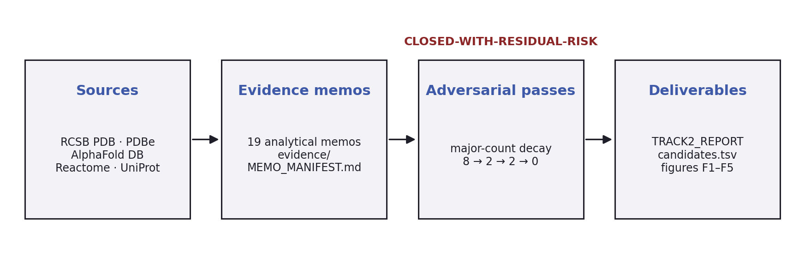
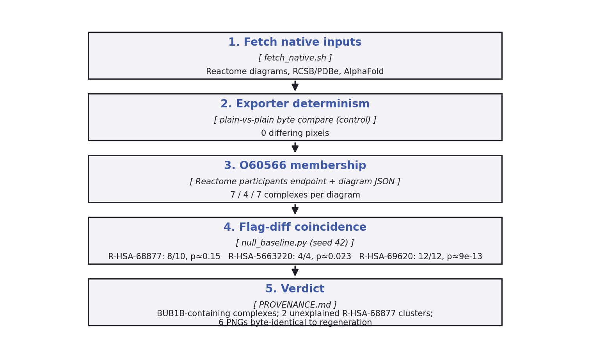

# Track 2: Technical Documentation
**MVA Hackathon 2026 · Rare Disease, Real Kid · BUB1B / Mosaic Variegated Aneuploidy**

This document describes how the Track-2 deliverables in this repository are produced and
verified: the evidence workflow, the data sources and APIs it draws on, the
native-image verification harness, the figure set, the check harness, and the
candidate-table contract. It is the engineering companion to
[`TRACK2_REPORT.md`](../TRACK2_REPORT.md); it asserts no new science.

---

## 1. Purpose and scope

Track 2 of the challenge asks for a mechanism-grounded drug-reprioritization
dossier for the Track-1 diagnosis (biallelic BUB1B / Mosaic Variegated
Aneuploidy). The deliverables in this repository are:

| Artifact | Path | Role |
|---|---|---|
| Professional report | [`TRACK2_REPORT.md`](../TRACK2_REPORT.md), [`TRACK2_REPORT.pdf`](../TRACK2_REPORT.pdf) | The submission document: mechanism characterization, therapeutic landscape, exclusion jurisprudence, six-assay validation plan |
| Lay report | [`TRACK2_LAY_REPORT.md`](../TRACK2_LAY_REPORT.md), [`.pdf`](../TRACK2_LAY_REPORT.pdf) | Plain-language companion for the family/foundations audience |
| Candidate table | [`candidates.tsv`](../candidates.tsv) | 20-row machine-readable candidate register |
| Report figures | [`figures/`](../figures) | F1–F5 committed renders |
| Evidence pack | [`evidence/`](../evidence) | 19 analytical memos: 4 wave-2 + 5 wave-3 + 4 wave-4 + 3 literature scans + 3 mechanism memos, exactly as enumerated in [`evidence/MEMO_MANIFEST.md`](../evidence/MEMO_MANIFEST.md), plus the four adversarial review passes, adjudication memo, and structural-validation records |
| Native images | [`evidence/native_images/`](../evidence/native_images) | Third-party structural imagery with a full verification chain (§4) |
| Citation check | [`checks/check_citations.py`](../checks/check_citations.py) | Reference-consistency gate (§6) |

**Non-goals.** Track-1 (variant calling/ranking) lives in its own repository.
This document changes no scientific claim; where it quotes numbers, each is
traceable to a repository artifact named next to it.

---

## 2. Workflow architecture

The dossier was produced by a generation → adversarial-review → integrate loop,
documented in [`evidence/WORKFLOW_CONSENSUS.md`](../evidence/WORKFLOW_CONSENSUS.md)
(the session log) and closed per [`evidence/SCOPE_DECISION.md`](../evidence/SCOPE_DECISION.md):

1. **Wave-2 axis generation**: parallel research memos per mechanism axis
   (e.g. `wave2_StabilizationAxis.md`, `wave2_SenolyticAxis.md`,
   `wave2_CINSyndromeAxis.md`, `wave2_NonsenseAxis.md`), each an evidence memo.
2. **Adversarial passes**: an out-of-family reviewer attacked each integrated
   pack (`wave2_ADVERSARIAL_REVIEW.md`, `wave3_ADVERSARIAL_PASS2.md`,
   `wave4_ADVERSARIAL_PASS3.md`, `wave5_ADVERSARIAL_PASS4.md`); findings were
   fixed at the controller layer. Major-count decay per `SCOPE_DECISION.md`:
   **8 → 2 → 2 → 0** across the four passes.
3. **Closure**: pass 4 returned zero majors; the stop rule (two consecutive
   zero-major passes, second over fresh axes) was declared met:
   *"CONVERGENCE OUTCOME (2026-09-05): decay 8 → 2 → 2 → 0; pass 4 returned
   ZERO majors; workflow CLOSED-WITH-RESIDUAL-RISK."* Residuals are declared
   in `SCOPE_DECISION.md` (R1: no pass 5 exists).
4. **Contested anchors**: claims a wave could not settle received dedicated
   adjudication memos (e.g.
   [`adjudication_rapalog_contested_anchor.md`](../evidence/adjudication_rapalog_contested_anchor.md)).

The consensus matrix and candidate register are the *output* of this loop:
`candidates.tsv` carries a `consensus_status` column (INCLUDE /
INCLUDE-AS-METABOLIC-CONTEXT / EXCLUDE …) that the report's §4
(therapeutic landscape) mirrors; the indicators documented there are what the
six-assay validation plan (report §5) operationalizes.

**Attack map.** [`evidence/TRACK2_ATTACK_MAP.md`](../evidence/TRACK2_ATTACK_MAP.md)
lists, per report section, which claims were targeted and how each attack
resolved, the audit surface for a judge.



---

## 3. Data sources and APIs

All external data enters through named, citable endpoints. Exact URL patterns
live in [`evidence/native_images/fetch_native.sh`](../evidence/native_images/fetch_native.sh).

| Source | What we use | Endpoint pattern | Docs |
|---|---|---|---|
| **Reactome** | Native pathway diagrams (R-HSA-68877, R-HSA-69620, R-HSA-5663220); flagged export with `flg=O60566`; diagram layout JSON; participants membership | `ContentService/exporter/diagram/{stId}.png`, `download/current/diagram/{stId}.json`, `ContentService/data/participants/{stId}` | [reactome.org/dev/content-service](https://reactome.org/dev/content-service) |
| **RCSB PDB** | Assembly images for 6JKK, 6JKM | `https://cdn.rcsb.org/images/structures/{pdb}_assembly-1.jpeg` | [rcsb.org/docs/programmatic-access](https://www.rcsb.org/docs/programmatic-access) |
| **PDBe** | Deposited-chain statics for 6JKK, 6JKM | `https://www.ebi.ac.uk/pdbe/static/entry/{pdb}_deposited_chain_front_image-200x200.png` | [ebi.ac.uk/pdbe](https://www.ebi.ac.uk/pdbe/) |
| **AlphaFold DB** | AF-O60566-F1 model + per-residue confidence JSON | `https://alphafold.ebi.ac.uk/files/AF-O60566-F1-confidence_v6.json` | [alphafold.ebi.ac.uk/api-docs](https://alphafold.ebi.ac.uk/api-docs) |
| **UniProt** | O60566 (BUB1B) feature table cited in report captions | REST API | [uniprot.org/help/api](https://www.uniprot.org/help/api) |

Key facts established through these sources (all recorded in
[`evidence/native_images/PROVENANCE.md`](../evidence/native_images/PROVENANCE.md)):

- The Reactome exporter is **deterministic**: two unflagged fetches of the same
  diagram are byte-identical (negative control, 2026-09-24).
- The participants endpoint lists uniprot:**O60566** (BUB1B) as a component of
  **7 / 4 / 7 complexes** across R-HSA-68877 / R-HSA-5663220 / R-HSA-69620
  respectively, because BUB1B is a kinetochore component in those diagrams,
  never a standalone node (except on R-HSA-69620, where the `BUB1B` particle,
  `hBUBR1:hBUB3:MAD2*:CDC20` MCC and `MCC:APC/C` are drawn explicitly).
- The core SAC sub-pathways (R-HSA-141430/141444/141405, R-HSA-69618) carry
  `hasDiagram=false`; R-HSA-69620 is the diagrammed parent covering the arm.

Analysis libraries: [matplotlib](https://matplotlib.org/stable/api/pyplot_summary.html),
[numpy](https://numpy.org/doc/) [Pillow](https://pillow.readthedocs.io/en/stable/reference/Image.html),
[scipy.ndimage](https://docs.scipy.org/doc/scipy/reference/ndimage.html):
no hand-rolled statistics (binomial test via `scipy.stats.binomtest`).

---

## 4. Native-image verification chain

The structural imagery is not decorative: its claims are verified in three
steps, each independently checkable from committed artifacts. The full text,
including the negative control, the two *unexplained* R-HSA-68877 clusters, and
the withdrawn earlier wording, is
[`evidence/native_images/PROVENANCE.md`](../evidence/native_images/PROVENANCE.md).

1. **Fetch** ([`fetch_native.sh`](../evidence/native_images/fetch_native.sh)):
   non-destructive by default (`OUT` override for refresh), records sources.
2. **Flag-vs-plain diff maps**: exported with `flg=O60566`; determinism
   control proves diffs are real render changes, not timestamps.
3. **Grounding**: (a) participants membership (7/4/7 complexes, peDbIds
   listed); (b) coincidence of diff clusters with the verified complex nodes,
   priced against a null baseline: 1000 random 150-unit boxes, seed 42
   ([`null_baseline.py`](../evidence/native_images/null_baseline.py)):
   R-HSA-69620: **12/12** vs 9.9 % baseline, p ≈ 9e-13; R-HSA-5663220: **4/4**
   vs 38.8 %, p = 0.023; R-HSA-68877: **8/10** vs 58.6 %, p = 0.15;
   underpowered there, so membership (3a) is the anchor on that diagram.
4. **Readable zoom set**: [`make_readable.py`](../evidence/native_images/make_readable.py)
   builds overview + zoom sheets (`readable_*_overview/zoom.png`); crops from
   diff clusters, node names from diagram-JSON intersection. All six committed
   PNGs are **byte-identical** to regeneration from the archived inputs
   (`python3 make_readable.py <stId> <tmpdir>`, compared with `cmp`).



---

## 5. Report figure set F1–F5

Committed renders in [`figures/`](../figures); the report's captions (§2–§5)
name each figure's primary sources (UniProt O60566 feature table, Ensembl MANE
transcript, AlphaFold model, 6JKK crystal structure).

| Figure | Subject |
|---|---|
| F1_variant_structure.png | p.Asn1002Lys structural context (6JKK-based) |
| F2_BubR1_protein_map.png | BUBR1 functional-domain map with the two patient alleles |
| F3_BUB1B_gene_exon17.png | Exon-17 architecture for the ASO-skipping program |
| F4_decision_instrument.png | Gate instrument for therapeutic decisions |
| F5_consensus_process.png | The wave/consensus process summarized for the report |

Related structural artifacts: [`evidence/6JKK.cif`](../evidence/6JKK.cif),
[`evidence/6JKK.pdb`](../evidence/6JKK.pdb),
[`evidence/AF_BUB1B.pdb`](../evidence/AF_BUB1B.pdb),
[`evidence/plip_6jkk/`](../evidence/plip_6jkk) (PLiP interaction profile
outputs; PLiP = Protein–Ligand Interaction Profiler).

---

## 6. Citation check harness

[`checks/check_citations.py`](../checks/check_citations.py) is the
reference-consistency gate for the professional report:

```bash
python3 checks/check_citations.py $PWD   # run from anywhere; arg = repo root
```

It censuses the report's `[E#]` register (defined in report §8) against in-text
citations and prints `CENSUS OK` on success. The script recomputes the numbers
itself on every run; last run 2026-10-19: **77 base entries + 2 sub-rows (79
cited)**. Do not confuse this with the separate "90/90 registry-verified
citations" figure in the report (32+34+24 across the three waves; per-wave
literature-identifier verification,
recorded in [`evidence/WORKFLOW_CONSENSUS.md`](../evidence/WORKFLOW_CONSENSUS.md))
different ledger, different count. A failing census blocks ship, so run it
after any edit to `TRACK2_REPORT.md`.

---

## 7. Candidate-table contract

[`candidates.tsv`](../candidates.tsv): TSV, header + **20 data rows**.

| Column | Content |
|---|---|
| `candidate` | Therapy candidate (generic name or class) |
| `axis` | Mechanistic axis letter (proteostasis, senolysis, immune surveillance, …) |
| `MoA` | Mechanism of action, one sentence |
| `approval_status` | Regulatory positioning (e.g. "investigational; no approved indication") |
| `evidence_grade` | Letter grade (A/B/C × human/preclinical) |
| `supporting_n`, `contrasting_n` | Study counts pro/contra |
| `key_PMIDs_DOIs` | Pinned primary sources, `PMID|DOI; …` |
| `consensus_status` | Wave-loop verdict (INCLUDE / INCLUDE-AS-… / EXCLUDE + reason) |

(A trailing run of empty reviewer columns `0..8` was removed on 2026-10-19:
nothing consumed them and the populated content lives in `consensus_status`.)

The TSV and report §4 vote from the same consensus matrix; divergence between
them is a defect; the attack map tracks any found instance.

---

## 8. Reproduction

```bash
# native-image inputs (non-destructive; use OUT=/tmp/x to refresh)
evidence/native_images/fetch_native.sh

# verification & derived figures
python3 evidence/native_images/null_baseline.py            # prints baselines + p-values
python3 evidence/native_images/make_readable.py R-HSA-68877 /tmp/out

# doc figures (this file's two diagrams)
python3 docs/figures/build_figs.py

# report consistency gate
python3 checks/check_citations.py $PWD

# PDF of this document (pandoc, xelatex)
docs/build_pdf.sh
```

[pandoc manual](https://pandoc.org/MANUAL.html) governs PDF options; the
two `docs/figures/*.png` are regenerated by `docs/figures/build_figs.py`
(matplotlib, deterministic).

---

## 9. References

- Reactome pathway database: Gillespie et al., 2022,
  [PMID 34788843](https://pubmed.ncbi.nlm.nih.gov/34788843/).
- AlphaFold Protein Structure Database / prediction: Jumper et al., *Nature* 2021,
  [PMID 34265844](https://pubmed.ncbi.nlm.nih.gov/34265844/).
- PLiP (Protein–Ligand Interaction Profiler): Salentin et al., *Nucleic Acids
  Res.* 2015, [PMID 26089450](https://pubmed.ncbi.nlm.nih.gov/26089450/).
- RCSB Protein Data Bank: [rcsb.org/docs/programmatic-access](https://www.rcsb.org/docs/programmatic-access).
- PDBe: [ebi.ac.uk/pdbe](https://www.ebi.ac.uk/pdbe/).
- UniProt: [uniprot.org/help/api](https://www.uniprot.org/help/api).
- matplotlib: Hunter, *Comput. Sci. Eng.* 2007, ([matplotlib.org](https://matplotlib.org/stable/api/pyplot_summary.html)).
- Scientific-report citation block: see `TRACK2_REPORT.md` §8 (61+2 entries,
  registry-verified per §3 of that report).
